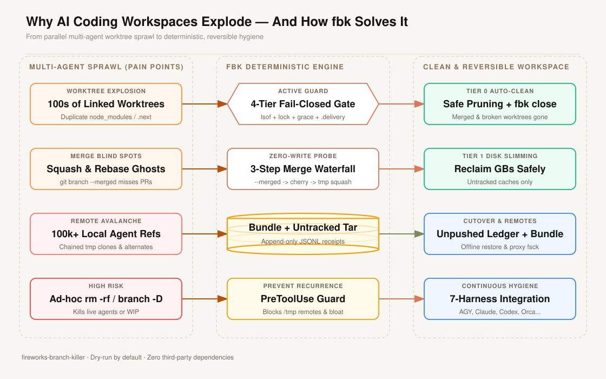
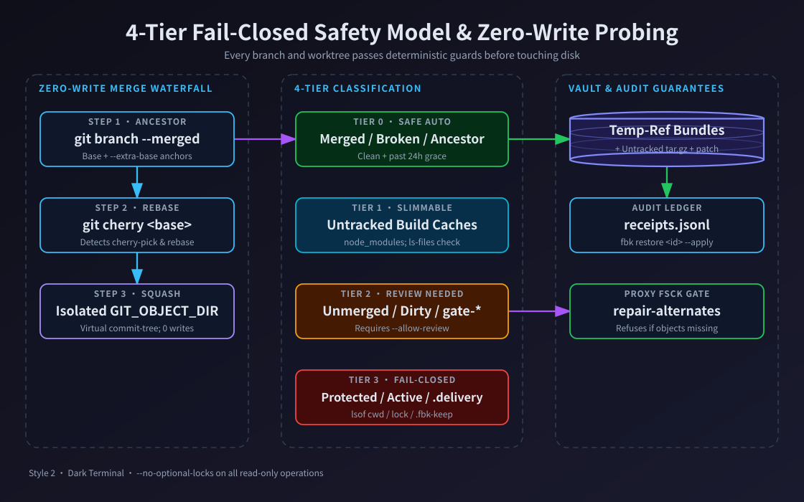
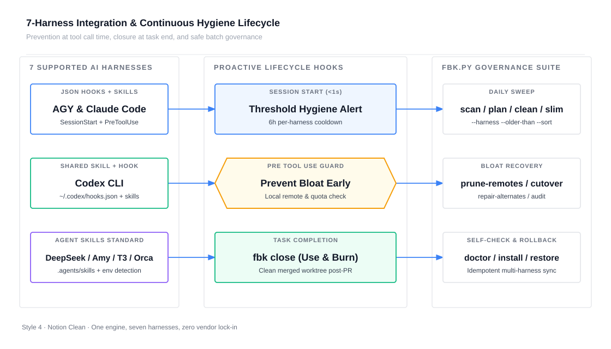

[English](README.md) | [中文](README.zh.md)

[Website](https://getfbk.dev) · [Architecture](docs/ARCHITECTURE.md) · [Deploy Website](docs/DEPLOY-WEBSITE.md) · [Safety Policy](references/safety-policy.md) · [Automation Setup](references/automation-setup.md) · [Changelog](CHANGELOG.md)

<p align="center">
  
</p>

<h1 align="center">fireworks-branch-killer</h1>

<p align="center">
  <strong>Stop letting AI coding agents turn your workspace into a worktree graveyard.</strong><br/>
  Zero-dependency deterministic Git worktree &amp; branch hygiene engine for Claude Code, Codex, Antigravity (AGY), DeepSeek Harness, Amy, T3 Code, and Orca.
</p>

<p align="center">
  <a href="LICENSE"></a>
  
  
  
  <a href=".github/workflows/ci.yml"></a>
</p>

---

## Why This Exists (The AI Coding Sprawl Pain Point)

Parallel AI coding is magical—until you inspect your workspace a month later:

* **Worktree explosion & duplicated GBs**: Every parallel task across Claude Code, Codex, AGY, T3 Code, or Orca spawns another linked worktree and duplicates `node_modules`, `.next`, `target`, `dist`, and `.venv`. Hundreds of idle worktrees quietly eat tens of gigabytes.
* **Squash & rebase ghost branches**: `git branch --merged` does **not** recognize GitHub Squash Merges or cherry-pick rebases, leaving thousands of already-shipped feature branches stuck forever.
* **Local `refs/remotes` avalanches & chained clones**: Agents adding local agent paths as remotes or cloning from `/tmp` / artifact folders create 100k+ dangling `refs/remotes`, broken `.git/objects/info/alternates`, and pseudo-primary clone chains.
* **Fear of `rm -rf` / `git branch -D`**: Letting an LLM improvise cleanup shell commands risks nuking another live agent's working tree, deleting unpushed WIP, or missing untracked files.



---

## Design Philosophy

`fireworks-branch-killer` (`fbk`) splits **LLM judgment** from **deterministic Git execution**:

1. **Deterministic Engine over Ad-Hoc Shell Guessing**: Agents invoke `scripts/fbk.py` instead of raw `rm -rf` or `git branch -D`.
2. **Dry-Run by Default & Fail-Closed Guards**: Every mutating command previews first and requires `--apply`. If `git status` errors or `lsof` is unavailable, batch `--apply` refuses instead of guessing clean.
3. **Zero-Write Probing**: Read-only scans always pass `--no-optional-locks`, and virtual squash-merge probes run inside an isolated `GIT_OBJECT_DIRECTORY` so zero loose objects are written into your real repo.
4. **Hardened Recovery Vault**: Every non-ancestor branch deletion, unmerged detached HEAD, or confirmed dirty worktree snapshots a verifiable `.bundle` (via temp ref), `git diff` patch, and untracked `.tar.gz` before deletion, logged to append-only `receipts.jsonl`.
5. **Prevention + Incremental Closure**: `SessionStart` warns gently, `PreToolUse` catches `/tmp` `git remote add` and worktree quota bloat before it happens, and `fbk close` cleans each task right after merge ("use & burn").



---

## 7-Harness Compatibility & Continuous Lifecycle

One skill package and one universal hook adapter (`scripts/hook_adapter.py`) cover the full multi-agent ecosystem:

| Harness | Skill Discovery | Native Hook / Guard Integration | Auto-Detected Worktree Patterns |
| :--- | :--- | :--- | :--- |
| **Antigravity (AGY)** | `.agents/skills/` | `.agents/hooks.json` (`SessionStart` + `PreToolUse`) | `agy-*`, `ge\d+-*`, `pro-worker-ge\d+`, `.gemini` |
| **Claude Code** | `.claude/skills/` (symlink) | `.claude/settings.json` (`SessionStart` + `PreToolUse`) | `.claude/worktrees/*`, `claude-*`, `pro-claude` |
| **Codex** | `.agents/skills/` / `~/.codex/skills/` | `~/.codex/hooks.json` (`SessionStart`) + `AGENTS.md` | `.codex/worktrees/*`, `~/.codex/worktrees/*`, `codex*` |
| **DeepSeek Harness** | `.agents/skills/` | `AGENTS.md` + `hook_adapter.py --harness deepseek-harness` | `wt-ds*`, `ds\d*-*`, `deepseek*`, `.scratch-ds*` |
| **Amy** | `.agents/skills/` | `AGENTS.md` + `hook_adapter.py --harness amy` | `.amy/worktrees/*`, `~/.amy/worktrees/*`, `amy-*` |
| **T3 Code** | `.agents/skills/` | `AGENTS.md` + `hook_adapter.py --harness t3-code` | `.t3/worktrees/*`, `~/.t3/worktrees/*`, `t3-*` |
| **Orca** | `.agents/skills/` | Auto-detected via `ORCA_PANE_KEY` / `ORCA_WORKTREE_ID` | `.orca/worktrees/*`, `~/.orca/worktrees/*`, `orca-*` |



---

## Installation

### Option 1: Install as an AI Agent Skill via `npx skills` (Recommended)

Use the nested skill path `/skills/fireworks-branch-killer` so `skills` CLI installs the complete package (`SKILL.md`, `scripts/`, `bin/`, `references/`, `assets/`, `tests/`):

```bash
npx -y skills@1.5.17 add \
  yizhiyanhua-ai/fireworks-branch-killer/skills/fireworks-branch-killer \
  --agent codex claude-code -g -y --copy
```

### Option 2: Zero-Install CLI via `npx`

Run `fbk` directly from GitHub without cloning or global install:

```bash
npx -y github:yizhiyanhua-ai/fireworks-branch-killer scan --root . --fast --no-size
```

*(Once published to npmjs registry, `npx -y @yizhiyanhua-ai/fireworks-branch-killer` works identically.)*

### Option 3: Clone & Auto-Wire All 7 Harnesses

```bash
git clone https://github.com/yizhiyanhua-ai/fireworks-branch-killer.git
cd fireworks-branch-killer

# Wire current workspace (.agents/hooks.json, .claude/skills, .claude/settings.json)
python3 scripts/fbk.py install --target all --scope workspace --workspace /path/to/workspace --apply

# Or wire user-global skills, ~/.codex/hooks.json, and ~/.local/bin/fbk
python3 scripts/fbk.py install --target all --scope global --apply
```

---

## Quick Start & Dual-Track Usage (Natural Language + CLI)

After installing the skill, you never need to memorize flags—just speak naturally inside **Claude Code / Codex / AGY / Amp**, or invoke the deterministic CLI directly:

| Goal | Ask Your Agent Naturally | Or Run Directly via CLI |
| :--- | :--- | :--- |
| **Evolving workspace checkup** | *"Run fbk doctor on this repo and check my space-saving tips"* | `fbk doctor --root .` |
| **View living local playbook** | *"Show my evolving fbk space-saving playbook"* | `fbk doctor --show-playbook` |
| **Record a new custom lesson** | *"Save a lesson in fbk doctor: clear .next/cache weekly"* | `fbk doctor --root . --learn "Clear .next/cache weekly" --stack js-ts` |
| **Keep code, slim idle caches** | *"Use fbk to slim node_modules/.next/target in idle worktrees"* | `fbk slim --root . --apply` |
| **Close a merged PR worktree** | *"PR merged—close this worktree and branch with fbk"* | `fbk close --worktree ./wt-feat --apply` |
| **Batch Tier-0 cleanup / restore** | *"Preview Tier-0 cleanup with fbk"* / *"Restore last deleted branch"* | `fbk clean --root . --tier 0 --apply` / `fbk restore <id> --apply` |

*(Or prepend `python3 scripts/fbk.py` if `~/.local/bin/fbk` is not in `PATH`, or run ad-hoc via `npx -y github:yizhiyanhua-ai/fireworks-branch-killer ...`.)*

### 1. Read-Only Multi-Repo Audit (`scan` & `plan`)
```bash
# Fast parallel scan across nested containers, worktrees, unpushed commits & pseudo-primary clones
python3 scripts/fbk.py scan --root /path/to/workspace --fast --no-size

# Filter by harness, age, and sort by disk size
python3 scripts/fbk.py plan --root /path/to/workspace --tier 0 --harness codex,claude-code --older-than 7 --sort size
```

### 2. Safe Tier-0 Auto-Cleanup (`clean`)
```bash
# Dry-run first (always default), then apply
python3 scripts/fbk.py clean --root /path/to/workspace --tier 0 --gc --apply
```

### 3. Incremental Task Closure (`close`)
```bash
# Right after your PR squash-merges or rebases into main
python3 scripts/fbk.py close --worktree /path/to/wt --apply

# Abandon an experimental branch (archives bundle to Recovery Vault first)
python3 scripts/fbk.py close --branch feat/experiment --force-unmerged --apply
```

### 4. Reclaim Disk Space Without Deleting Code (`slim`)
```bash
# Removes untracked node_modules/.next/target/dist/.venv in idle worktrees; skips git-tracked files
python3 scripts/fbk.py slim --root /path/to/workspace --apply
```

### 5. Extreme Bloat & Recovery (`prune-remotes`, `cutover-bundle`, `repair-alternates`, `audit-remote`, `restore`)
```bash
# Strip local/tmp agent remotes and pack refs (never touches canonical origin)
python3 scripts/fbk.py prune-remotes --repo /path/to/repo --apply

# Export unpushed branches manifest + offline bundle before fresh-clone cutover
python3 scripts/fbk.py cutover-bundle --repo /path/to/repo --apply

# Verify self-containment via isolated proxy `git fsck --connectivity-only` before pruning dead alternates
python3 scripts/fbk.py repair-alternates --repo /path/to/repo

# Offline 3-tier audit of origin branches (read-only)
python3 scripts/fbk.py audit-remote --repo /path/to/repo

# Roll back any vaulted branch or extract archived untracked files
python3 scripts/fbk.py restore --list
python3 scripts/fbk.py restore <receipt_id> --apply
```

---

## Root-Cause Space-Saving Tips (Full-Stack Prevention)

Cleaning merged worktrees (`close`/`clean`) and trimming idle caches (`slim`) solves accumulated bloat—combining `fbk` with **root-cause deduplication** prevents new worktrees from copying gigabytes of dependencies upfront.

`fbk doctor --root .` is **dynamically self-evolving**: every run inspects your real stacks (including sampling `st_nlink > 1` hardlinks vs exclusive `.next/cache` / `target/` hogs), clears warnings you fixed into **Resolved Wins**, ingests real cleanup savings from `clean`/`slim`/`close`, and maintains a personal `<state_dir>/playbook.md` without dirtying your Git checkout (`--learn` adds custom lessons, `--show-playbook` prints it, `--no-evolve` stays strictly read-only). Full guide: [references/space-saving-tips.md](references/space-saving-tips.md):

| Stack / Layer | Root-Cause Pattern | Key Gotcha & `fbk` Synergy |
| :--- | :--- | :--- |
| **Claude Code** | `worktree.symlinkDirectories: ["node_modules", ".cache"]` | Remove trailing `/` in `.gitignore` (`node_modules`, **not** `node_modules/`), or `git add` stages symlinks! `fbk slim` skips symlinks (`follow_symlinks=False`) safely. |
| **JS / TS (`pnpm` / `bun`)** | `virtualStoreType: global` in `pnpm-workspace.yaml` / `bun` APFS CoW | **Hardlink trap**: standard `pnpm` hardlinks `node_modules` to global store—deleting a worktree alone barely frees physical disk until you run `pnpm store prune`; real exclusive hogs are `target/` & `.next/cache`. |
| **Browser E2E / QA** | Global `PLAYWRIGHT_BROWSERS_PATH`, `PUPPETEER_CACHE_DIR`, `CYPRESS_CACHE_FOLDER` | Avoids 400MB–1.2GB browser copies; set `trace`/`video: "retain-on-failure"`. |
| **Python & AI / ML** | `uv` with `UV_LINK_MODE=clone` (macOS) + external `HF_HOME` / `TORCH_HOME` | Keep `UV_CACHE_DIR` on same volume so APFS `clone` works without full copies. |
| **Rust** | `RUSTC_WRAPPER=sccache` (parallel) or `CARGO_TARGET_DIR` (serial) | Eliminates 5–20GB `target/` per worktree; let `fbk slim` trim idle targets. |
| **Go / Mobile / Docker / Git** | Shared `GOMODCACHE` / `GRADLE_USER_HOME` / `DerivedData`, `docker compose down -v`, `git maintenance start` | Prefer `git worktree` over full `git clone`; use macOS `cp -cR` for zero-copy APFS duplicates. |

---

## Comparison

| Capability | `git branch --merged` / `worktree prune` | Ad-Hoc LLM `rm -rf` | `fireworks-branch-killer` (`fbk`) |
| :--- | :--- | :--- | :--- |
| Squash & rebase merge detection | No | Unreliable | **Yes** (3-step zero-write waterfall) |
| Active agent `lsof` / `.delivery` / lock guard | No | No | **Yes** (fail-closed Tier 3 protection) |
| Chained clones, `gate-*` & nested containers | No | Often misses | **Yes** (bounded depth-3 discovery) |
| Untracked cache slimming (`git ls-files` safe) | No | Risky | **Yes** (Tier 1 cache-only slimming) |
| Reversible Recovery Vault + JSONL receipts | No | No | **Yes** (`.bundle` + untracked `.tar.gz`) |
| Proactive `PreToolUse` prevention hooks | No | No | **Yes** (`SessionStart` + `PreToolUse`) |

---

## Sponsors

Interested in sponsoring? Contact: <a href="mailto:ccc7574@gmail.com">ccc7574@gmail.com</a>

---

## Work With the Builder

This project is part of the `yizhiyanhua-ai` developer-tool suite turning messy AI coding workflows into deterministic, auditable engineering systems.

- Founder-facing profile: https://bradzhang.dev/en
- Work with me: https://bradzhang.dev/en/work-with-me

## License

[MIT](LICENSE)
