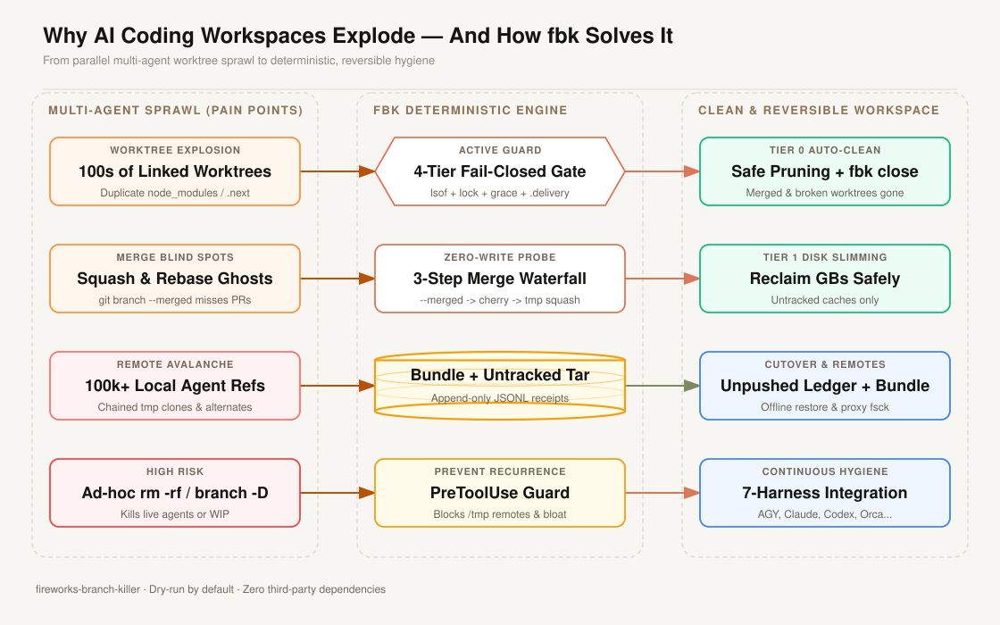
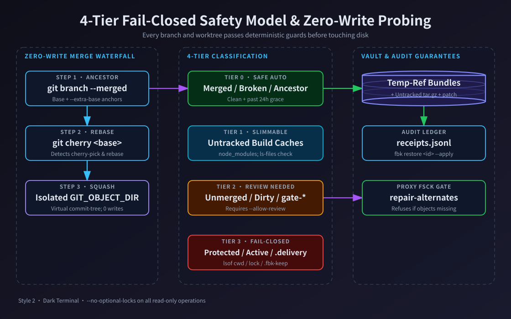
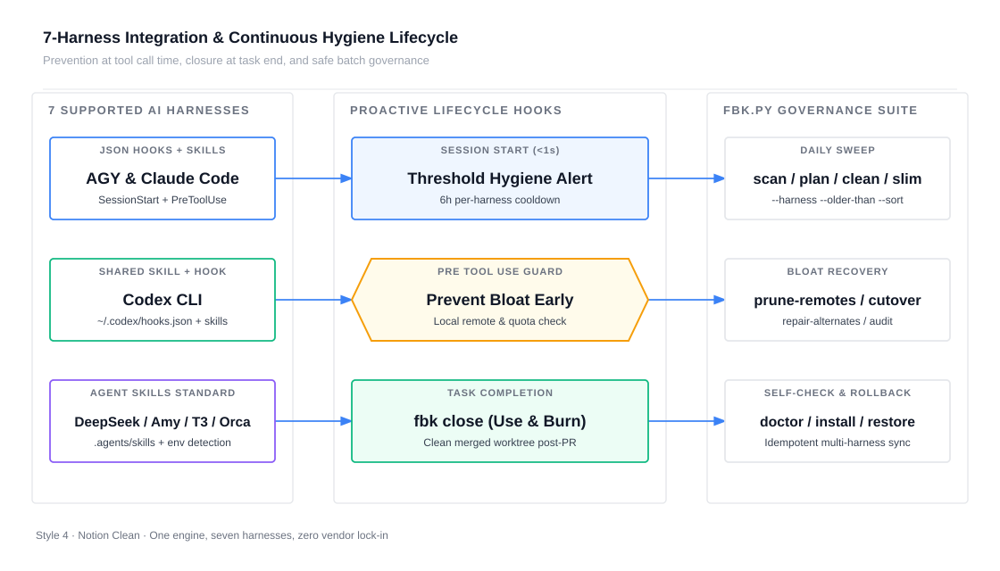

[English](README.md) | [中文](README.zh.md)

[架构设计](docs/ARCHITECTURE.md) · [安全策略](references/safety-policy.md) · [跨 Harness 自动化接入](references/automation-setup.md) · [更新日志](CHANGELOG.md)

<p align="center">
  
</p>

<h1 align="center">fireworks-branch-killer</h1>

<p align="center">
  <strong>别再让 AI 编程助手把你的工作区变成 Worktree 坟场。</strong><br/>
  零依赖、确定性、Fail-Closed 的 Git Worktree 与 Feature 分支治理引擎，原生兼容 Claude Code、Codex、Antigravity (AGY)、DeepSeek Harness、Amy、T3 Code 与 Orca。
</p>

<p align="center">
  <a href="LICENSE"></a>
  
  
  
  <a href=".github/workflows/ci.yml"></a>
</p>

---

## 为什么需要它（AI Coding 的真实痛点）

多 Agent 并行写代码爽一时，几周后打开工作目录往往已是灾难现场：

* **Worktree 爆炸与十数 GB 磁盘重复占用**：Claude Code、Codex、AGY、T3 Code、Orca 每次并行任务都新建一个 worktree，随之重复拷贝 `node_modules`、`.next`、`target`、`dist`、`.venv`，动辄吞掉几十 GB 磁盘空间。
* **Squash / Rebase Merge 幽灵分支盲区**：常规 `git branch --merged` 根本识别不了 GitHub Squash Merge 或 Cherry-pick Rebase，导致早已合入主干的分支积压到上千条。
* **本地 `refs/remotes` 雪崩与套娃克隆**：Agent 互相添加本地路径或 `/tmp` 作为 remote，导致单仓涌现 **10 万+** 条 `refs/remotes`、失效 `.git/objects/info/alternates` 以及层层套娃的临时克隆。
* **不敢手动 `rm -rf` / `git branch -D`**：让大模型临场拼命令批量清理，极易误杀正在干活的另一路 Agent、丢掉尚未推送的本地提交或未跟踪新文件。



---

## 设计理念

`fireworks-branch-killer`（`fbk`）坚持**「AI 负责判断时机，确定性引擎负责安全执行」**：

1. **确定性脚本取代模型猜命令**：所有扫描与清理一律通过零依赖 Python 引擎 `scripts/fbk.py` 执行，不让 LLM 临场拼接高危删除命令。
2. **默认 Dry-Run + Fail-Closed 硬保护**：一切变更操作必须显式传 `--apply` 才动盘；遇到 `git status` 报错或 `lsof` 进程检查不可用时，批量清理直接拒执行（Fail-Closed）。
3. **零写入只读探测**：全部只读命令自动携带 `--no-optional-locks`；三步合并瀑布中的虚拟 Squash 探测运行在临时隔离 `GIT_OBJECT_DIRECTORY` 中，**对真实仓库 `.git/objects/` 零写入**。
4. **加固型恢复保险丝（Recovery Vault）**：凡删除非祖先合并分支、未合入 `detached HEAD` 或脏工作树，必先备份完整 `.bundle`（经临时 ref）、`git diff` 补丁及未跟踪文件 `.tar.gz`，并写入只追加 `receipts.jsonl` 收据，随时一键 `restore`。
5. **事前防复发 + 用完即焚**：`SessionStart` 超阈轻量提醒、`PreToolUse` 拦截本地/`/tmp` `git remote add` 与超配额建工作树、`fbk close` 在每次任务合入后即刻收尾。



---

## 七大 Harness 兼容与全生命周期防护

一套核心引擎（`fbk.py`）+ 一套多协议 Hook 适配器（`hook_adapter.py`），跨工具共用无锁死：

| Harness | Skill 发现机制 | Hook / 启动与事前护栏 | 自动识别 Worktree 规则 |
| :--- | :--- | :--- | :--- |
| **Antigravity (AGY)** | `.agents/skills/` | `.agents/hooks.json`（`SessionStart` + `PreToolUse`） | `agy-*`, `ge\d+-*`, `pro-worker-ge\d+`, `.gemini` |
| **Claude Code** | `.claude/skills/`（软链） | `.claude/settings.json`（`SessionStart` + `PreToolUse`） | `.claude/worktrees/*`, `claude-*`, `pro-claude` |
| **Codex** | `.agents/skills/` / `~/.codex/skills/` | `~/.codex/hooks.json`（`SessionStart`）+ `AGENTS.md` | `.codex/worktrees/*`, `~/.codex/worktrees/*`, `codex*` |
| **DeepSeek Harness** | `.agents/skills/` | `AGENTS.md` + `hook_adapter.py --harness deepseek-harness` | `wt-ds*`, `ds\d*-*`, `deepseek*`, `.scratch-ds*` |
| **Amy** | `.agents/skills/` | `AGENTS.md` + `hook_adapter.py --harness amy` | `.amy/worktrees/*`, `~/.amy/worktrees/*`, `amy-*` |
| **T3 Code** | `.agents/skills/` | `AGENTS.md` + `hook_adapter.py --harness t3-code` | `.t3/worktrees/*`, `~/.t3/worktrees/*`, `t3-*` |
| **Orca** | `.agents/skills/` | 自动识别 `ORCA_PANE_KEY` / `ORCA_WORKTREE_ID` | `.orca/worktrees/*`, `~/.orca/worktrees/*`, `orca-*` |



---

## 安装方式

### 方式一：通过 `npx skills` 一键安装到 Codex / Claude Code（推荐）

请使用完整嵌套路径 `/skills/fireworks-branch-killer`，确保 `skills` CLI 复制完整工具链（`SKILL.md`、`scripts/`、`bin/`、`references/`、`assets/`、`tests/`）：

```bash
npx -y skills@1.5.17 add \
  yizhiyanhua-ai/fireworks-branch-killer/skills/fireworks-branch-killer \
  --agent codex claude-code -g -y --copy
```

### 方式二：免安装直接通过 `npx` 运行 CLI

无需克隆或全局安装，直接一行命令体检任意工作区：

```bash
npx -y github:yizhiyanhua-ai/fireworks-branch-killer scan --root . --fast --no-size
```

*（发布到 npmjs 后同样支持 `npx -y @yizhiyanhua-ai/fireworks-branch-killer`。）*

### 方式三：克隆仓库并一键接入七大 Harness

```bash
git clone https://github.com/yizhiyanhua-ai/fireworks-branch-killer.git
cd fireworks-branch-killer

# 工作区级接入（自动配置 .agents/hooks.json、.claude/skills 与非破坏性合并 .claude/settings.json）
python3 scripts/fbk.py install --target all --scope workspace --workspace /path/to/workspace --apply

# 或全局同步（写入 ~/.agents/skills、~/.claude/skills、~/.codex/hooks.json 与 ~/.local/bin/fbk）
python3 scripts/fbk.py install --target all --scope global --apply
```

---

## 快速上手与命令手册

你可以直接用自然语言让任意 Agent 调用（如*“用 fbk 体检一下多余 worktree”*、*“收尾关闭这个已合并分支的 worktree”*、*“瘦身闲置 worktree 里的 node_modules”*），也可以直接运行 CLI：

### 1. 只读全局体检与精准规划（`scan` & `plan`）
```bash
# 多级穿透扫描（支持 --harness、--older-than、--sort、--limit、--extra-base）
python3 scripts/fbk.py scan --root /path/to/workspace --fast --no-size

# 预览 Tier 0 清理计划，按工具与时间筛选、按体积排序
python3 scripts/fbk.py plan --root /path/to/workspace --tier 0 --harness codex,claude-code --older-than 7 --sort size
```

### 2. Tier 0 无损自动清理（`clean`）
```bash
# 默认 dry-run 预览；确认无误后加 --apply 执行
python3 scripts/fbk.py clean --root /path/to/workspace --tier 0 --gc --apply
```

### 3. 单任务用完即焚收尾（`close`）
```bash
# PR Squash/Rebase 合入主干后立即清理该 worktree 与分支
python3 scripts/fbk.py close --worktree /path/to/wt --apply

# 主动废弃实验分支（删前自动打 bundle 进恢复保险丝）
python3 scripts/fbk.py close --branch feat/experiment --force-unmerged --apply
```

### 4. 不删源码和分支，仅清理闲置缓存释放磁盘（`slim`）
```bash
# 清理闲置工作树中的 node_modules/.next/target/dist/.venv（自动跳过被 Git 跟踪的文件）
python3 scripts/fbk.py slim --root /path/to/workspace --apply
```

### 5. 重度积压治理与还原（`prune-remotes`、`cutover-bundle`、`repair-alternates`、`audit-remote`、`restore`）
```bash
# 剥离本地/tmp 僵尸 remote 并压缩 refs（绝不触碰规范 origin）
python3 scripts/fbk.py prune-remotes --repo /path/to/repo --apply

# 为极端爆炸仓导出未推送分支底账 + 可离线还原的 git bundle（便于 Clean-Slate Cutover 迁往干净新仓）
python3 scripts/fbk.py cutover-bundle --repo /path/to/repo --apply

# 先用隔离代理执行 `git fsck --connectivity-only` 校验自包含，确认安全再修剪失效 alternates
python3 scripts/fbk.py repair-alternates --repo /path/to/repo

# 只读离线三档审计远端 origin 分支（已合入 / 超30天归档候选 / 近14天待认领）
python3 scripts/fbk.py audit-remote --repo /path/to/repo

# 查看保险丝并一键还原被删分支或未跟踪文件
python3 scripts/fbk.py restore --list
python3 scripts/fbk.py restore <receipt_id> --apply
```

---

## 方案对比

| 能力 | 原生 `git branch --merged` / `worktree prune` | 让 LLM 临场拼 `rm -rf` | `fireworks-branch-killer` (`fbk`) |
| :--- | :--- | :--- | :--- |
| Squash / Rebase 合并识别 | 不支持 | 不稳定 | **支持**（零写入三步合并瀑布） |
| 活跃进程 `lsof` / `.delivery` / 锁保护 | 不支持 | 无保护 | **支持**（Fail-Closed Tier 3 硬拦截） |
| 多级嵌套目录、套娃克隆与 `gate-*` 识别 | 不支持 | 易漏/易误伤 | **支持**（3 层有界穿透发现） |
| 仅清缓存保源码（含 `git ls-files` 防误删） | 不支持 | 高风险 | **支持**（Tier 1 安全瘦身） |
| 恢复保险丝（`.bundle` + 未跟踪 `.tar.gz`） | 不支持 | 不可逆 | **支持**（全量收据 + `restore` 还原） |
| 事前防复发 `PreToolUse` 护栏 | 不支持 | 无 | **支持**（`SessionStart` + `PreToolUse`） |

---

## 赞助商

有兴趣成为赞助商？请联系：<a href="mailto:ccc7574@gmail.com">ccc7574@gmail.com</a>

---

## 与作者合作

本项目是 `yizhiyanhua-ai` 开发者工具矩阵的一部分，专注于将容易失控的 AI Coding 工作流改造为确定性、可审计、可回滚的工程基础设施。

- 个人主页：https://bradzhang.dev/en
- 合作咨询：https://bradzhang.dev/en/work-with-me

## 开源协议

[MIT](LICENSE)
